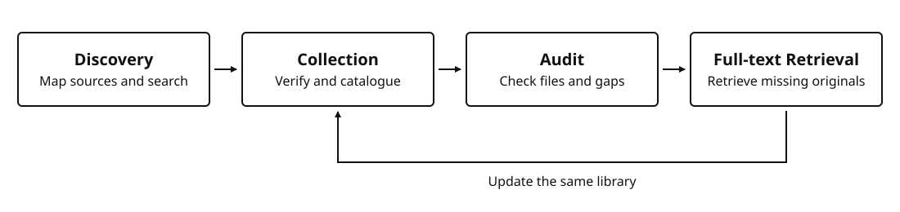

# Global Legal & Policy Research Skill

[简体中文](README_CN.md) · [HawkLab](https://github.com/HawklLab) · [Releases](https://github.com/HawklLab/global-legal-policy-research/releases)

A Codex skill for building traceable research libraries across jurisdictions. Use it to map official sources, search in relevant languages, trace legislative history and advocacy, retrieve originals, audit evidence, and publish a local catalogue. Developed independently by HawkLab. The project does not represent any institution or international organization.


## Quick start

With Node.js 22.20 or later, run this from the project where you want the skill. The [Skills CLI](https://github.com/vercel-labs/skills) places it in `.agents/skills/global-legal-policy-research`.

```sh
npx --yes skills add https://github.com/HawklLab/global-legal-policy-research --skill global-legal-policy-research -a codex -y
```

Install the Python dependency in the environment Codex will use, then start a new Codex session from the project.

```sh
python3 -m pip install -r .agents/skills/global-legal-policy-research/requirements.txt
```

Ask Codex to use `$global-legal-policy-research`, or follow the [fixed-version installation](#installation) below. The [Skills.sh detail page](https://www.skills.sh/hawkllab/global-legal-policy-research/global-legal-policy-research) was accessible on 2026-11-25, while site search for the exact skill name returned no results.

## Workflow and modes



| Mode | Typical request | Local command |
| --- | --- | --- |
| Discovery | Find official sources and map a new question | `research_run.py discovery RUN --config CONFIG` |
| Collection | Verify candidates and catalogue acquired originals | `research_run.py collection RUN` |
| Audit | Check source, version, attachment and coverage evidence | `research_run.py audit RUN --output CHECKS` |
| Full-text Retrieval | Recover missing originals from an existing catalogue | `research_run.py full-text-retrieval RUN --output QUEUE` |

Commands above are relative to `scripts/` and run with Python. Discovery prepares the local run. Codex executes live discovery, search and download steps with the browsing tools available to it. The local tools maintain templates, a jurisdictional source registry, a resumable search journal, verification evidence, citation and version relationships, and a retrieval queue. See [workflow](references/workflow.md) and [record formats](references/records.md).

## Installation

For the current project-level version, see [Quick start](#quick-start).

Requires Python 3.9+ and [openpyxl](https://openpyxl.readthedocs.io/). Poppler's `pdfinfo` and `pdftotext` are optional for automatic PDF checks. Scans and non-text media still require manual evidence.

From a local checkout, use an empty destination:

```sh
skill_dir="${CODEX_HOME:-$HOME/.codex}/skills/global-legal-policy-research"
mkdir -p "$(dirname "$skill_dir")"
mkdir "$skill_dir" && git archive HEAD | tar -x -C "$skill_dir"
python3 -m pip install -r requirements.txt
```

Install the tagged release from the [GitHub repository](https://github.com/HawklLab/global-legal-policy-research). Use an unused destination or name when keeping another installation.

```sh
python3 "${CODEX_HOME:-$HOME/.codex}/skills/.system/skill-installer/scripts/install-skill-from-github.py" \
  --repo HawklLab/global-legal-policy-research --path . --name global-legal-policy-research --ref v0.1.0 --method download
```

Install the Python requirements from the installed folder, then restart Codex or begin a session that discovers the installed skill. The live GitHub command requires a reachable published repository.

## Troubleshoot Git HTTP/2 errors

If installation reports `curl 92`, `HTTP/2 stream … was not closed cleanly`, or `early EOF`, retry with HTTP/1.1 for this process and its child processes on macOS or Linux. This keeps your saved Git configuration intact.

```sh
GIT_CONFIG_COUNT=1 GIT_CONFIG_KEY_0=http.version GIT_CONFIG_VALUE_0=HTTP/1.1 \
  npx --yes skills add https://github.com/HawklLab/global-legal-policy-research --skill global-legal-policy-research -a codex -y
```

If the same error persists, use the [tagged archive installation](#installation). For authentication or repository-not-found errors, check the repository URL and access separately.

## Example

> Use `$global-legal-policy-research` to collect the adopted EU Artificial Intelligence Act and its preparatory documents. Search EUR-Lex in English and German. Save the adopted text, record its connection to the Commission proposal, and produce a bilingual catalogue. Record any unavailable originals.

1. Start with the [adopted Regulation (EU) 2024/1689](https://eur-lex.europa.eu/eli/reg/2024/1689/oj) and [procedure 2021/0106/COD](https://eur-lex.europa.eu/procedure/EN/2021_106).
2. Follow the procedure's listing for Commission proposal COM(2021) 206. Keep the proposal and the adopted act as separate records linked by legislative history. Keep the procedure page in the source or search records when it only serves as a finding aid.
3. Ask Codex to audit the catalogue, confirm each saved file opens from its workbook link, and queue only items still lacking complete originals.

The repository provides links and workflow instructions. The example writes its files locally.

```json
{
  "country": "EU",
  "topic": "Artificial intelligence regulation",
  "research_scope": "Adopted regulation and preparatory documents",
  "search_languages": ["en", "de"],
  "output_language": "bilingual",
  "preserve_original_title": true,
  "translate_title": true
}
```

The example limits queries to two languages. For a general run, ask Codex to verify the relevant official languages and include English. When presentation language is omitted, Codex follows the user's conversation language and writes `user_language`; the CLI defaults to English if neither setting is present. Use `en`, `zh-CN` or `bilingual`. Working translations are supplemental. Keep original metadata in the backend even when hiding the original-title display column values with `preserve_original_title: false`.

## Profiles and localized delivery

Use a profile by ID, ask Codex to create one from a clear scope, or omit it for general coverage and document types. Copy [the template](profiles/template.md) to a local `<id>.md` next to the run config or into staging, put that ID in `research_profile`, and use stable codes in the [classification table](references/records.md). Put only material research-boundary decisions to the user. Profiles define the scope, languages, priorities, custom categories, themes, dimensions, inclusion and stopping criteria. They preserve core evidence and access rules.

Supply localized titles and prose in staging `presentation.json`. Values may use `{"en": "...", "zh-CN": "..."}`. Supported fields include `country`, `topic`, `scope`, `titles` and `issues` (keyed by record ID), `gaps` (a list) and `note`. Titles are added only when supplied or already recorded as English title metadata. Original author or publisher names, original source URLs, legal identifiers and DOIs remain intact. User-supplied prose appears as entered when no matching translation is available.

One stable output directory per jurisdiction and topic contains one workbook, an originals directory, research notes and backend records, with localized names. The workbook has three sheets for the catalogue, record-level issues and sources. Keep the outer destination path stable across languages. Re-render an existing snapshot through a sibling staging directory to replace its presentation:

```sh
python3 scripts/start_increment.py outputs/eu-ai work/eu-ai
python3 scripts/package_delivery.py work/eu-ai outputs/eu-ai --update --output-language en
```

No search or download is involved in re-rendering. Preserve human edits by carrying them back into staging or presentation fields before publishing updates.

## Limitations and contributing

Live tools, network access, jurisdictional search coverage and licensing vary. Dynamic registries, paywalls, digitized archives and scanned or audiovisual files may require user-reviewed evidence or remain inaccessible. The CLI never logs in or crawls sites by itself. The catalogue is an evidence-management aid, not a comprehensive statement of the law or legal advice.

Run `python3 -m unittest discover -s scripts -v`. Submit minimal reproducible examples with synthetic or appropriately authorized public metadata. Keep private records, raw downloads, credentials and unpublished materials outside the repository. See [license](LICENSE) and [dependency notes](THIRD_PARTY.md).

See [CITATION.cff](CITATION.cff) for scholarly citation metadata. The [compatibility matrix](.github/workflows/tests.yml) runs the Python suite on Linux, macOS and Windows. Codex invocation and Skills CLI installation are separate end-to-end checks.
