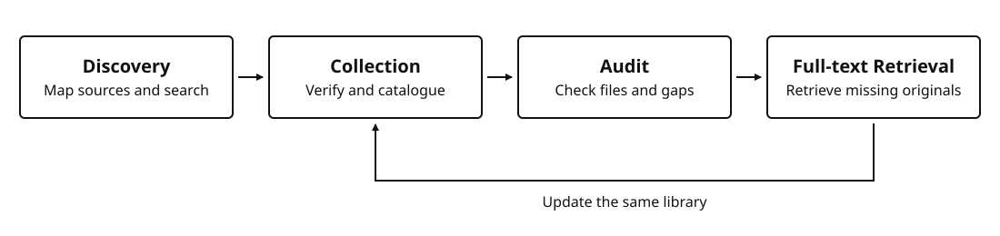

# Global Legal & Policy Research Skill

跨国法律与政策资料研究

[English](README.md) · [HawkLab](https://github.com/HawklLab) · [发布版本](https://github.com/HawklLab/global-legal-policy-research/releases)

这是 HawkLab 独立开发的 Codex Skill，可发现官方法律来源、开展多语言检索、追踪立法与倡导过程、获取和核验原文，并生成可追溯的本地资料目录。它不代表任何研究机构或国际组织。


## 快速安装

使用 Node.js 22.20 或更新版本，在目标项目目录运行。[Skills CLI](https://github.com/vercel-labs/skills) 会将它安装到 `.agents/skills/global-legal-policy-research`。

```sh
npx --yes skills add https://github.com/HawklLab/global-legal-policy-research --skill global-legal-policy-research -a codex -y
```

在 Codex 将使用的 Python 环境中安装依赖，然后从该项目开启新的 Codex 会话。

```sh
python3 -m pip install -r .agents/skills/global-legal-policy-research/requirements.txt
```

在对话中调用 `$global-legal-policy-research`。如需复现特定版本，见[固定版本安装](#安装与使用)。2026-11-25 核查时，[Skills.sh 详情页](https://www.skills.sh/hawkllab/global-legal-policy-research/global-legal-policy-research)可访问，但站内按完整名称搜索未返回结果。

## 工作流程



| 模式 | 用法 |
| --- | --- |
| Discovery | 发现并核实官方来源，再按所选语种检索和登记 |
| Collection | 核实候选资料，获取合法全文并编制目录 |
| Audit | 检查既有来源、附件、版本关系和覆盖 |
| Full-text Retrieval | 优先复用已有附件，定向补齐缺失全文 |

由 Codex 使用当前环境的联网工具执行实际检索和下载。Python 工具负责初始化、持久化来源与检索记录、断点续跑、核验、排队和整理。见[执行流程](references/workflow.md)和[记录格式](references/records.md)。

## 安装与使用

需要 Python 3.9+ 和 `requirements.txt` 中的 openpyxl。PDF 自动检查可选安装 Poppler。安装前选择空的 Skill 目录，已有同名 Skill 时请使用独立测试目录或自定义安装名称。详见 [English README 的本地与 GitHub 安装命令](README.md#installation)。可从 [GitHub 仓库](https://github.com/HawklLab/global-legal-policy-research)安装固定版本。

```sh
python3 "${CODEX_HOME:-$HOME/.codex}/skills/.system/skill-installer/scripts/install-skill-from-github.py" \
  --repo HawklLab/global-legal-policy-research --path . --name global-legal-policy-research --ref v0.1.0 --method download
```


## Git HTTP/2 传输错误

安装时如遇 `curl 92`、`HTTP/2 stream … was not closed cleanly` 或 `early EOF`，可在 macOS 或 Linux 上用 HTTP/1.1 重试。设置只对本次命令及其启动的进程生效。

```sh
GIT_CONFIG_COUNT=1 GIT_CONFIG_KEY_0=http.version GIT_CONFIG_VALUE_0=HTTP/1.1 \
  npx --yes skills add https://github.com/HawklLab/global-legal-policy-research --skill global-legal-policy-research -a codex -y
```

若问题持续，可改用[固定版本的归档下载](#安装与使用)。遇到身份验证失败或仓库找不到时，请分别核对仓库地址和访问权限。

## 使用示例

> 用 `$global-legal-policy-research` 搜集欧盟《人工智能法》及其立法准备文件。在 EUR-Lex 用英语和德语检索，保存通过版条例，记录它与欧盟委员会提案的关系，生成中英双语目录。未取得的原文也请登记。

1. 从[通过版条例 (EU) 2024/1689](https://eur-lex.europa.eu/eli/reg/2024/1689/oj)和[立法程序档案 2021/0106/COD](https://eur-lex.europa.eu/procedure/EN/2021_106)入手。
2. 通过程序档案查找委员会提案 COM(2021) 206。提案与通过版分别登记，并记录立法关系。若程序页仅用于定位原文，则登记在来源或检索记录中。
3. 请 Codex 核验目录中的本地文件链接，再把缺少完整原文的资料纳入补充队列。

案例只在本地生成资料库。配置示例见 [English README](README.md#example)。

## 国际化与专题

- `search_languages` 记录实际检索语种。未指定时由 Codex 核实目标管辖区相关的官方研究语种，并加上英语。
- `output_language` 支持 `en`、`zh-CN` 和 `bilingual`。对话任务默认沿用交流语言，并通过 `user_language` 传入。独立命令无此设置时默认英文。
- `preserve_original_title` 默认显示原文题名。设为 false 时目录隐藏该列的值，后台仍保留原文。`translate_title` 控制辅助译名，不修改原文题名、原机构名、文号、DOI 或链接。
- 在暂存目录的 `presentation.json` 中提供各语言的题名、范围、缺口和备注。可用 `{"en": "...", "zh-CN": "..."}`。缺少译文时保留已有文本，底层字段、状态代码和资料编号独立于输出语言。
- 可指定已有专题、要求 Codex 按明确范围生成专题，或使用通用框架。把[专题模板](profiles/template.md)复制为本地 `<id>.md` 并写入 `research_profile`。专题可配置分类、主题、研究维度、纳入规则和停止条件。关键边界不明确时由研究者确认。

## 交付与更新

同一管辖区及专题维护一份正式资料库。顶层包括三表工作簿、文献原文、检索说明和后台记录，按输出语言命名。待补表只列具体资料问题，检索缺口另写入说明。原始数据、检索语言、资料编号和文件身份可跨语言重用。用下列命令重新排版，无需联网：

```sh
python3 scripts/start_increment.py outputs/eu-ai work/eu-ai
python3 scripts/package_delivery.py work/eu-ai outputs/eu-ai --update --output-language zh-CN
```

## 限制、贡献与免责声明

动态站点、付费资料、纸本档案、扫描件和媒体需要人工核验或合法权限。脚本不代替浏览器执行检索，不绕过访问限制。目录仅辅助资料管理，不构成法律意见或完整的法律现状说明。

运行 `python3 -m unittest discover -s scripts -v`。提交问题或改进时使用合成记录或有公开授权的资料，避免带入私人研究数据和凭据。见[许可](LICENSE)和[依赖说明](THIRD_PARTY.md)。

学术引用信息见 [CITATION.cff](CITATION.cff)。[兼容性矩阵](.github/workflows/tests.yml)在 Linux、macOS 和 Windows 上运行 Python 测试。Skills CLI 安装和 Codex 调用单独进行端到端验证。
